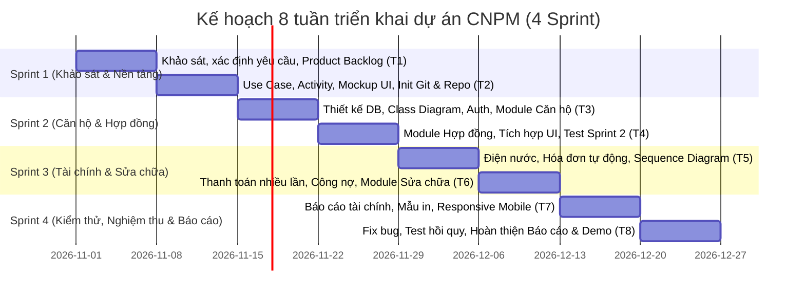

# 📋 KẾ HOẠCH PHÂN CHIA CÔNG VIỆC DỰ ÁN BTL CÔNG NGHỆ PHẦN MỀM
## Đề tài: Hệ Thống Quản Lý Cho Thuê Căn Hộ Dịch Vụ
> **Phương pháp tiếp cận:** Agile / Scrum (8 tuần — 4 Sprint, 2 tuần/Sprint)  
> **Quy mô:** 9 thành viên (5 DT — Development Team + 4 rAI — Business Analyst & Quality/Documentation)  
> **Áp dụng chuẩn:** Báo cáo môn học CNPM, chuẩn UML 2.5, Quản lý mã nguồn trên Git / GitHub

---

## 🎯 1. Mục tiêu cụ thể hóa theo mô hình SMART (Mục 1.2.3)

| Thành phần SMART | Nội dung áp dụng trong dự án |
|---|---|
| **Cụ thể (Specific)** | Xây dựng phần mềm web hoàn chỉnh quản lý căn hộ dịch vụ với các phân hệ: Quản lý tài khoản & phân quyền (RBAC); Quản lý căn hộ, tình trạng phòng, hồ sơ khách thuê; Quản lý hợp đồng thuê; Ghi nhận chỉ số điện nước theo kỳ; Lập hóa đơn tự động; Ghi nhận thanh toán nhiều lần và theo dõi công nợ lũy kế; Tiếp nhận và xử lý yêu cầu sửa chữa/sự cố; Báo cáo tài chính (phải thu, thực thu, công nợ). |
| **Đo lường được (Measurable)** | - Hoàn thành 100% yêu cầu chức năng cốt lõi bắt buộc đã chốt. - Xây dựng tối thiểu **30 test cases** kiểm thử toàn diện. - Đạt 100% test cases nghiệp vụ cốt lõi trước ngày nghiệm thu. - 0 lỗi nghiêm trọng (Critical/Blocker) gây sai lệch tiền tệ, mất mát dữ liệu hoặc truy cập trái quyền. |
| **Khả thi (Achievable)** | Tổ chức 9 thành viên phối hợp chặt chẽ theo chuyên môn (Frontend, Backend, Database, QA/Tester, Business Analyst, Báo cáo & Tài liệu). Ưu tiên làm chắc các chức năng cốt lõi trước, các tính năng nâng cao (IoT điện nước, thanh toán trực tuyến) để ở giai đoạn phát triển sau. |
| **Phù hợp (Relevant)** | Giải quyết trực tiếp các bài toán nhức nhối thực tế đã ghi nhận từ khảo sát: loại bỏ sai sót tính nhẩm/Excel, đối soát minh bạch tiền khách đóng nhiều đợt, lưu trữ lịch sử điện nước không bị thất lạc, chuẩn hóa quy trình xử lý sự cố. |
| **Có thời hạn (Time-bound)** | Thực hiện nghiêm ngặt trong **8 tuần**, chia đều làm **4 Sprint** (mỗi Sprint kéo dài đúng 2 tuần). |

---

## 👥 2. Bảng phân công chi tiết cho 9 thành viên (Mục 1.5 & 1.6)

### 2.1. Phân loại vai trò
- **DT (Development Team - 5 thành viên):** Chịu trách nhiệm thiết kế kiến trúc kỹ thuật, CSDL, lập trình giao diện, backend APIs, tích hợp và kiểm thử phần mềm.
- **rAI (Research / Analysis / Information & Quality - 4 thành viên):** Chịu trách nhiệm khảo sát thực tế, phân tích nghiệp vụ, mô hình hóa quy trình (Activity/Use Case), chuẩn bị bộ dữ liệu mẫu, chuẩn hóa tài liệu báo cáo và quản lý quy chế đạo đức AI (AUR).

---

### 2.2. Chi tiết phân công từng thành viên

#### 👤 1. Vũ Thị Thùy Dung — DT (Frontend & UI/UX Lead)
* **Vai trò:** Lập trình Frontend & Thiết kế trải nghiệm người dùng (UI/UX).
* **Nhánh Git phụ trách:** `feature/dung-frontend-ui`
* **Nhiệm vụ chi tiết:**
  - Thiết kế bản vẽ giao diện mẫu (Mockup/Wireframe hoặc Figma) cho toàn bộ các màn hình chức năng.
  - Xây dựng giao diện cho 2 phân hệ người dùng chính: **Người quản lý / Chủ cơ sở** (Dashboard quản trị, bảng phòng, danh sách hợp đồng, bảng điện nước, hóa đơn, sự cố) và **Khách thuê** (Xem thông tin phòng, xem hóa đơn, gửi yêu cầu sửa chữa).
  - Kết nối giao diện với các RESTful APIs của Backend.
  - Tối ưu hóa giao diện hiển thị đa thiết bị (Responsive Design) trên cả máy tính (Desktop/Laptop) và điện thoại thông minh (Mobile Web).
* **Sản phẩm bàn giao:**
  - Bộ Mockup giao diện mẫu;
  - Mã nguồn hoàn chỉnh các trang frontend (`src/frontend/`);
  - Giao diện đã kết nối dữ liệu thật và vượt qua bài test hiển thị trên đa kích thước màn hình.
* **Tiêu chí hoàn thành (DoD):** Giao diện chạy mượt mà, không vỡ layout, thao tác dễ dàng trên cả trình duyệt Desktop và Mobile; mã nguồn được review và merge vào `develop`.

---

#### 👤 2. Nguyễn Đình Đức — DT (Database & Core Backend Lead)
* **Vai trò:** Chủ trì thiết kế CSDL & Backend phân hệ Cốt lõi (Căn hộ, Khách thuê, Hợp đồng).
* **Nhánh Git phụ trách:** `feature/duc-core-backend`
* **Nhiệm vụ chi tiết:**
  - Chủ trì thiết kế mô hình dữ liệu quan hệ (ERD) và cơ sở dữ liệu vật lý (Physical Schema, bảng, khóa chính, khóa ngoại, ràng buộc toàn vẹn).
  - Phối hợp với nhóm BA để chuẩn hóa mô hình và vẽ **Class Diagram** chi tiết cho hệ thống.
  - Lập trình backend APIs cho phân hệ Quản lý căn hộ (thêm, sửa, xóa, lọc theo trạng thái phòng: trống, đã thuê, bảo trì).
  - Lập trình backend APIs cho phân hệ Hồ sơ khách thuê (thông tin cá nhân, CCCD, số điện thoại, người ở cùng).
  - Lập trình backend APIs cho phân hệ Hợp đồng thuê (tạo hợp đồng mới, gia hạn, chấm dứt, tính tiền cọc, ràng buộc ngày bắt đầu/kết thúc).
* **Sản phẩm bàn giao:**
  - Script khởi tạo CSDL (`schema.sql` hoặc DB Migrations);
  - File biểu đồ **Class Diagram** đạt chuẩn UML 2.5;
  - Bộ mã nguồn Backend và tài liệu API cho phân hệ Căn hộ, Khách thuê và Hợp đồng (`src/backend/modules/core/`).
* **Tiêu chí hoàn thành (DoD):** Toàn bộ API CRUD căn hộ/khách/hợp đồng hoạt động ổn định, kiểm soát chặt chẽ ràng buộc khóa ngoại và điều kiện nghiệp vụ; mã nguồn merge vào `develop`.

---

#### 👤 3. Nguyễn Hoàng Long — DT (Financial & Billing Backend Lead)
* **Vai trò:** Backend phân hệ Tài chính, Điện nước, Hóa đơn & Công nợ.
* **Nhánh Git phụ trách:** `feature/long-finance-billing`
* **Nhiệm vụ chi tiết:**
  - Xây dựng chức năng ghi chỉ số điện nước theo kỳ và theo từng căn hộ; kiểm tra tính hợp lệ của dữ liệu (chỉ số mới ≥ chỉ số cũ, không nhập trùng kỳ).
  - Lập trình logic tính phí dịch vụ tự động theo định mức hoặc đơn giá cố định.
  - Xây dựng module tự động sinh hóa đơn hàng tháng dựa trên thông tin hợp đồng và số điện/nước tiêu thụ.
  - Xây dựng chức năng ghi nhận thanh toán nhiều lần cho cùng một hóa đơn (khách trả trước một phần); tự động cập nhật số dư nợ.
  - Lập trình thuật toán theo dõi công nợ tích lũy và xây dựng APIs báo cáo tổng hợp: Số tiền phải thu, Số tiền thực thu và Công nợ còn lại theo từng kỳ.
* **Sản phẩm bàn giao:**
  - Bộ mã nguồn phân hệ Điện nước, Hóa đơn, Thanh toán và Công nợ (`src/backend/modules/billing/`);
  - Module báo cáo tài chính tổng hợp;
  - Bộ tài liệu API tài chính & kết quả kiểm tra thuật toán tính toán theo bộ dữ liệu mẫu (Golden dataset) đã thống nhất với BA.
* **Tiêu chí hoàn thành (DoD):** Tính toán chính xác 100% đến từng đồng, không làm tròn sai lệch; xử lý đúng các trường hợp thanh toán 1 lần hoặc thanh toán nhiều đợt; test pass 100%.

---

#### 👤 4. Ninh Văn Thành Trung — DT (Security, Auth & Maintenance Backend Lead)
* **Vai trò:** Backend Xác thực & Phân hệ Quản lý Yêu cầu Sửa chữa.
* **Nhánh Git phụ trách:** `feature/trung-auth-maintenance`
* **Nhiệm vụ chi tiết:**
  - Xây dựng phân hệ Đăng nhập, Đăng xuất, Quản lý phiên làm việc (Session/JWT) và Phân quyền truy cập (RBAC) dựa trên ma trận phân quyền đã được duyệt.
  - Đảm bảo cơ chế bảo mật mật khẩu (mã hóa hash/bcrypt), bảo vệ các routes API chống truy cập trái quyền.
  - Xây dựng phân hệ Quản lý yêu cầu sửa chữa: Khách thuê tạo yêu cầu sự cố (hỏng bóng đèn, tắc nước,...); Quản lý tiếp nhận, phân công, cập nhật trạng thái (`Mới` → `Đang xử lý` → `Hoàn thành`) và lưu trữ lịch sử trao đổi.
  - Phối hợp vẽ các biểu đồ **Sequence Diagram** cho các luồng quan trọng: Đăng nhập/Xác thực và Luồng Tiếp nhận & Xử lý sự cố sửa chữa.
* **Sản phẩm bàn giao:**
  - Mã nguồn phân hệ Xác thực & Phân quyền (`src/backend/modules/auth/`);
  - Mã nguồn phân hệ Yêu cầu Sửa chữa (`src/backend/modules/maintenance/`);
  - File biểu đồ **Sequence Diagram** cho luồng Auth và luồng Sửa chữa.
* **Tiêu chí hoàn thành (DoD):** Khách thuê chỉ xem và tạo được yêu cầu trong phạm vi căn hộ của mình; Admin có toàn quyền điều phối; không có lỗ hổng IDOR hoặc lộ thông tin; Sequence Diagram đồng bộ 100% với code.

---

#### 👤 5. Nguyễn Đình Ước — DT (QA / Test Lead & Release Engineer)
* **Vai trò:** Chủ trì công tác kiểm thử phần mềm, Quản lý lỗi (Bug Tracking) và Đóng gói phát hành.
* **Nhánh Git phụ trách:** `feature/uoc-qa-testing`
* **Nhiệm vụ chi tiết:**
  - Chủ trì lập Kế hoạch kiểm thử tổng thể (Test Plan) cho 4 Sprint.
  - Xây dựng bộ kịch bản kiểm thử (Test Cases) tối thiểu **30 ca kiểm thử** bao phủ đầy đủ: ca kiểm thử luồng chính (Happy path), ca kiểm thử biên (Boundary values), ca kiểm thử dữ liệu không hợp lệ (Negative test) và kiểm tra bảo mật phân quyền.
  - Thực hiện kiểm thử tích hợp (Integration Testing), kiểm thử giao diện (UI Testing) và kiểm thử hồi quy (Regression Testing) sau mỗi lần merge code.
  - Quản lý danh sách lỗi phát sinh (Bug tracking log), phân loại mức độ nghiêm trọng và đôn đốc các thành viên DT khắc phục lỗi.
  - Chuẩn bị môi trường chạy thử (demo environment), file cài đặt/docker-compose, tài liệu hướng dẫn cài đặt và Hướng dẫn sử dụng hệ thống (User Manual).
* **Sản phẩm bàn giao:**
  - Kế hoạch kiểm thử (Test Plan);
  - Bộ 30+ Test Cases chi tiết kèm kết quả pass/fail (`docs/test_plans/test_cases.md`);
  - Bảng theo dõi và khắc phục lỗi (Bug Log);
  - Báo cáo kết quả kiểm thử (Test Summary Report);
  - Bản chạy thử hoàn chỉnh và Tài liệu hướng dẫn sử dụng.
* **Tiêu chí hoàn thành (DoD):** 100% test cases cốt lõi pass; không còn bug mức High/Critical; tài liệu hướng dẫn dễ hiểu, người ngoài đọc vào chạy được ngay.

---

#### 👤 6. Nguyễn Hải Long — rAI (Business Analyst — Core Modules)
* **Vai trò:** Khảo sát và Phân tích nghiệp vụ phân hệ Căn hộ, Khách thuê, Hợp đồng.
* **Nhiệm vụ chi tiết:**
  - Khảo sát thực tế các cơ sở cho thuê căn hộ dịch vụ về quy trình quản lý phòng, bàn giao căn hộ, quản lý hợp đồng thuê và hồ sơ người thuê.
  - Nhận diện các rủi ro và khó khăn trong việc quản lý hồ sơ thủ công (hết hạn hợp đồng không kịp gia hạn, không kiểm soát được số người cư trú,...).
  - Viết tài liệu đặc tả yêu cầu chức năng (Functional Requirements - FR) cho phân hệ Căn hộ, Khách thuê, Hợp đồng.
  - Xây dựng danh sách và viết chi tiết các kịch bản **Đặc tả Use Case (Use Case Specifications)** cho các nghiệp vụ phụ trách.
* **Sản phẩm bàn giao:**
  - Biên bản khảo sát nghiệp vụ thực tế;
  - Danh mục yêu cầu chức năng phân hệ cốt lõi;
  - Bảng đặc tả chi tiết các Use Case: Thêm/Sửa/Tìm kiếm Căn hộ, Tiếp nhận hồ sơ khách, Tạo và thanh lý Hợp đồng.
* **Tiêu chí hoàn thành (DoD):** Bản đặc tả rõ ràng, đầy đủ các bước thực hiện, luồng nhánh và điều kiện tiên quyết; được thành viên DT (Nguyễn Đình Đức) xác nhận khả thi trước khi code.

---

#### 👤 7. Bùi Phương Minh — rAI (Business Analyst — Financial Modules)
* **Vai trò:** Phân tích chuyên sâu nghiệp vụ Tài chính, Điện nước, Hóa đơn & Công nợ.
* **Nhiệm vụ chi tiết:**
  - Phân tích chi tiết quy trình chốt số điện nước, cách tính tiền điện nước (theo giá bậc thang nhà nước hoặc đơn giá khoán của chủ cơ sở).
  - Phân tích quy tắc lập hóa đơn tổng hợp cuối tháng, quy trình thanh toán nhiều đợt và cơ chế tính trừ dần công nợ.
  - Xác định rõ ràng các công thức tính toán, dữ liệu đầu vào bắt buộc và các trường hợp ngoại lệ (khách chuyển vào giữa tháng, ghi nhầm chỉ số đồng hồ bị giảm, khách trả thiếu hoặc trả thừa).
  - Xây dựng biểu đồ hoạt động **Activity Diagram** mô tả quy trình ghi điện nước, lập hóa đơn và thanh toán.
  - Xây dựng **Bộ dữ liệu kiểm thử chuẩn (Golden Dataset)** với các số liệu thực tế để phối hợp với Nguyễn Hoàng Long và Nguyễn Đình Ước đối soát kết quả tính toán của phần mềm.
* **Sản phẩm bàn giao:**
  - Tài liệu quy tắc nghiệp vụ tài chính và công thức tính tiền chi tiết;
  - Tài liệu đặc tả chức năng điện nước, hóa đơn, công nợ;
  - File biểu đồ **Activity Diagram** quy trình nghiệp vụ tài chính;
  - Bảng số liệu mẫu (Golden Dataset) dùng làm căn cứ kiểm thử tính toán.
* **Tiêu chí hoàn thành (DoD):** Công thức toán học rõ ràng, không mâu thuẫn; biểu đồ Activity thể hiện đầy đủ các quyết định nghiệp vụ và nhánh rẽ.

---

#### 👤 8. Vũ Thị Thanh — rAI (Project Coordinator & Lead Reporter)
* **Vai trò:** Nghiên cứu so sánh hệ thống, Yêu cầu phi chức năng, Chủ trì biên tập Báo cáo & Quản lý Quy tắc AI.
* **Nhiệm vụ chi tiết:**
  - Nghiên cứu, đánh giá và lập **Bảng so sánh chi tiết** các hệ thống/giải pháp liên quan: Sổ ghi chép/Excel, Smartos PMS, Landsoft Building và giải pháp phần mềm đề xuất của nhóm (Mục 1.3).
  - Xác định các nhóm tác nhân (Actors) và thiết lập **Ma trận phân quyền (RBAC Matrix)** giữa Quản trị viên và Khách thuê.
  - Phân tích và soạn thảo danh mục **Yêu cầu phi chức năng (Non-Functional Requirements - NFR)** về hiệu năng, tính bảo mật, tính khả dụng và khả năng tương thích đa thiết bị.
  - Chủ trì tổng hợp, biên tập và chuẩn hóa toàn bộ file văn bản Báo cáo môn học (định dạng Docx / Google Docs) theo đúng quy chuẩn trình bày của Khoa/Trường: căn lề, mục lục, danh mục bảng biểu lặp lại tiêu đề trang 2, trích dẫn tài liệu tham khảo đúng chuẩn.
  - Thiết lập và quản lý **Quy tắc sử dụng công cụ AI (Mục 1.8 - AUR.01 đến AUR.99)** và phụ trách viết **Phụ lục Z: Nhật ký sử dụng AI** kèm hệ thống footnote dẫn chiếu trong toàn bộ quyển báo cáo.
* **Sản phẩm bàn giao:**
  - Bảng so sánh các hệ thống liên quan (Mục 1.3.4);
  - Ma trận phân quyền chi tiết (RBAC Matrix);
  - Danh sách yêu cầu phi chức năng (NFR);
  - Bảng đặc tả Use Case Đăng nhập / Đăng xuất;
  - Toàn bộ quyển Báo cáo tổng hợp môn học hoàn chỉnh (từ Lời mở đầu, Chương 1 đến Chương 6, Phụ lục A đến Z);
  - Phụ lục Z: Nhật ký sử dụng AI hoàn chỉnh.
* **Tiêu chí hoàn thành (DoD):** Quyển báo cáo được định dạng đẹp, không lỗi chính tả, trích dẫn chuẩn chỉ, đầy đủ chữ ký xác nhận đóng góp của 9 thành viên; tuân thủ 100% quy định của giảng viên.

---

#### 👤 9. Nguyễn Tuyết Mai — rAI (Business Analyst — Maintenance & Survey Lead)
* **Vai trò:** Khảo sát nghiệp vụ Sửa chữa, Xử lý số liệu thực tế & Ẩn danh hóa dữ liệu.
* **Nhiệm vụ chi tiết:**
  - Trực tiếp khảo sát thực tế tại các căn hộ dịch vụ về cách thức tiếp nhận phản ánh hư hỏng thiết bị (điều hòa, bóng đèn, khóa cửa, ống nước).
  - Xác định các trường thông tin cần lưu trữ khi tạo yêu cầu, các trạng thái vòng đời của một phiếu sửa chữa (`Chờ xử lý`, `Đang sửa`, `Đã nghiệm thu`, `Hủy`).
  - Xây dựng biểu đồ hoạt động **Activity Diagram** mô tả toàn diện quy trình từ lúc khách thuê phát hiện sự cố đến khi người quản lý điều phối thợ sửa và nghiệm thu xong.
  - Phụ trách tổng hợp toàn bộ kết quả khảo sát sơ bộ của nhóm (Mục 1.1.2), vẽ biểu đồ tròn/cột thống kê khó khăn; thực hiện việc **ẩn danh hóa dữ liệu (Data Anonymization)** để bảo vệ thông tin cá nhân của người được khảo sát theo đúng chuẩn học thuật.
* **Sản phẩm bàn giao:**
  - Bảng tổng hợp số liệu khảo sát và biểu đồ thống kê đã được ẩn danh;
  - Bảng đặc tả Use Case nghiệp vụ Tiếp nhận & Xử lý yêu cầu sửa chữa;
  - File biểu đồ **Activity Diagram** quy trình xử lý sự cố.
* **Tiêu chí hoàn thành (DoD):** Dữ liệu khảo sát trung thực, đã loại bỏ thông tin nhạy cảm; biểu đồ Activity Diagram chuẩn UML; phối hợp với Ninh Văn Thành Trung để hoàn thiện chức năng.

---

## 📅 3. Kế hoạch triển khai theo tuần (Tuần 1 — Tuần 8 / 4 Sprint) (Mục 1.7.2)

### 🗓️ Chi tiết từng tuần:

#### 🔹 Tuần 1: Khởi động & Khảo sát nghiệp vụ
* **Trọng tâm:** Đối chiếu kết quả khảo sát thực tế; làm rõ quy trình tại cơ sở; thu thập mẫu biểu hợp đồng, hóa đơn, sổ ghi điện nước; xác định các tác nhân (Actors), phạm vi hệ thống và danh sách yêu cầu bắt buộc.
* **Người thực hiện:** Nguyễn Hải Long, Bùi Phương Minh, Nguyễn Tuyết Mai, Vũ Thị Thanh (chủ trì); toàn nhóm góp ý.
* **Kết quả đầu ra:** Tài liệu khảo sát nghiệp vụ, Danh sách yêu cầu ban đầu (FR & NFR), Product Backlog sơ bộ.

#### 🔹 Tuần 2: Chốt yêu cầu, Mô hình hóa & Dựng nền tảng (Review Sprint 1)
* **Trọng tâm:** Chốt tiêu chí chấp nhận cho các User Stories; xây dựng Use Case Diagram tổng quan và các Activity Diagram luồng chính; phác thảo Mockup giao diện; khởi tạo kho lưu trữ Git trên GitHub, thiết lập môi trường lập trình và khung mã nguồn (base project).
* **Người thực hiện:** Vũ Thị Thùy Dung (Mockup UI), Nguyễn Hải Long & Bùi Phương Minh & Nguyễn Tuyết Mai (UML), Nguyễn Đình Đức & Ninh Văn Thành Trung (Setup Git repo, backend skeleton).
* **Kết quả đầu ra:** Bộ biểu đồ Use Case & Activity Diagram tổng quan, Bộ giao diện mẫu (Mockup/Wireframe), Git Repository hoạt động, Biên bản rà soát kết thúc Sprint 1.

#### 🔹 Tuần 3: Thiết kế CSDL & Xây dựng phân hệ Cốt lõi
* **Trọng tâm:** Thiết kế mô hình dữ liệu quan hệ (ERD) và Class Diagram; xây dựng phân hệ Đăng nhập, Quản lý tài khoản và Phân quyền truy cập (RBAC); bắt đầu lập trình phân hệ Quản lý căn hộ và Hồ sơ khách thuê.
* **Người thực hiện:** Nguyễn Đình Đức (chủ trì DB, Class Diagram & CRUD Căn hộ/Khách), Ninh Văn Thành Trung (Auth/RBAC), Vũ Thị Thùy Dung (giao diện Căn hộ & Khách thuê).
* **Kết quả đầu ra:** CSDL ban đầu (Schema SQL), Class Diagram, Phân hệ Xác thực & Quản lý Căn hộ/Khách thuê cơ bản.

#### 🔹 Tuần 4: Quản lý Hợp đồng & Tích hợp giao diện (Review Sprint 2)
* **Trọng tâm:** Hoàn thiện chức năng lập và quản lý hợp đồng thuê căn hộ, kiểm soát tình trạng phòng; tích hợp giao diện người dùng với APIs; thực hiện kiểm thử tạo, sửa, tìm kiếm và kiểm tra các trường hợp nhập dữ liệu không hợp lệ.
* **Người thực hiện:** Nguyễn Đình Đức (Hợp đồng), Vũ Thị Thùy Dung (Tích hợp UI), Nguyễn Đình Ước (Thực thi Test Cases cho Sprint 2), Nguyễn Hải Long (kiểm tra đối chiếu nghiệp vụ).
* **Kết quả đầu ra:** Luồng quản lý phòng - khách - hợp đồng chạy liên kết trơn tru; Báo cáo kiểm thử Sprint 2.

#### 🔹 Tuần 5: Phân hệ Điện nước & Lập Hóa đơn tự động
* **Trọng tâm:** Xây dựng chức năng ghi chỉ số điện nước theo kỳ; cấu hình đơn giá dịch vụ; xây dựng thuật toán tự động sinh hóa đơn hàng tháng; vẽ Sequence Diagram cho luồng lập hóa đơn; kiểm tra kết quả tính tiền theo bộ dữ liệu mẫu (Golden dataset).
* **Người thực hiện:** Nguyễn Hoàng Long (chủ trì Backend Billing), Bùi Phương Minh (cung cấp công thức & Golden data), Ninh Văn Thành Trung (hỗ trợ Sequence Diagram), Vũ Thị Thùy Dung (giao diện nhập chỉ số và xem hóa đơn).
* **Kết quả đầu ra:** Phân hệ ghi chỉ số và tự động sinh hóa đơn hoạt động chính xác; Sequence Diagram Lập hóa đơn.

#### 🔹 Tuần 6: Thanh toán nhiều lần, Quản lý Sự cố sửa chữa (Review Sprint 3)
* **Trọng tâm:** Lập trình chức năng ghi nhận khách thanh toán nhiều đợt cho cùng hóa đơn, tự động bù trừ công nợ; xây dựng phân hệ tiếp nhận, xử lý và lưu vết lịch sử yêu cầu sửa chữa; kiểm thử bảo mật phân quyền (khách thuê không xem được hóa đơn/yêu cầu của phòng khác).
* **Người thực hiện:** Nguyễn Hoàng Long (Thanh toán & Công nợ), Ninh Văn Thành Trung (Module Sửa chữa), Nguyễn Tuyết Mai (đối soát luồng sửa chữa), Nguyễn Đình Ước (Kiểm thử liên phân hệ Sprint 3).
* **Kết quả đầu ra:** Phân hệ tài chính và phân hệ sửa chữa hoàn thành tích hợp; Biên bản rà soát kết thúc Sprint 3.

#### 🔹 Tuần 7: Báo cáo tài chính, Mẫu in & Tối ưu Responsive đa thiết bị
* **Trọng tâm:** Xây dựng dashboard báo cáo tổng hợp: Số tiền phải thu, Thực thu, Công nợ tích lũy; bổ sung chức năng xuất mẫu in hóa đơn; tinh chỉnh giao diện hiển thị tối ưu trên thiết bị di động (Mobile Web); tiến hành kiểm thử tích hợp toàn hệ thống.
* **Người thực hiện:** Nguyễn Hoàng Long (API Báo cáo), Vũ Thị Thùy Dung (Tối ưu giao diện Mobile & Mẫu in), Nguyễn Đình Ước (Thực thi bộ 30+ Test Cases), Vũ Thị Thanh (rà soát NFR và biên tập báo cáo).
* **Kết quả đầu ra:** Bản phần mềm phiên bản Release Candidate (gần hoàn chỉnh), Danh mục lỗi (Bug log) toàn hệ thống.

#### 🔹 Tuần 8: Sửa lỗi, Kiểm thử hồi quy, Chuẩn hóa Báo cáo & Nghiệm thu
* **Trọng tâm:** Khắc phục triệt để các lỗi phát sinh, thực hiện kiểm thử hồi quy; cập nhật lại toàn bộ tài liệu và biểu đồ UML cho khớp 100% với code thực tế; đóng gói bản chạy thử và viết User Manual; hoàn thiện quyển Báo cáo tổng thể và chuẩn bị slide thuyết trình demo.
* **Người thực hiện:** Toàn bộ 9 thành viên tham gia, trong đó: Nguyễn Đình Ước (chủ trì Test hồi quy), Vũ Thị Thanh (chủ trì hoàn thiện quyển Báo cáo & Phụ lục Z), Nguyễn Đình Đức & Thùy Dung (chuẩn bị bản demo).
* **Kết quả đầu ra:** Bản nghiệm thu phần mềm hoàn chỉnh, Mã nguồn sạch trên GitHub, Quyển Báo cáo toàn diện (Word/PDF), Bộ Test Cases & Báo cáo kiểm thử đạt chuẩn.

---

## 📊 4. Ma trận trách nhiệm RACI cho 9 thành viên

*(R = Responsible - Người thực hiện chính; A = Accountable - Người chịu trách nhiệm phê duyệt/kết quả cuối cùng; C = Consulted - Người được tham vấn chuyên môn; I = Informed - Người được thông báo kết quả)*

| Hạng mục công việc | Thùy Dung | Đình Đức | Hoàng Long | Thành Trung | Đình Ước | Hải Long | Phương Minh | Thị Thanh | Tuyết Mai |
|---|:---:|:---:|:---:|:---:|:---:|:---:|:---:|:---:|:---:|
| **Khảo sát nghiệp vụ & Viết FR** | I | C | C | C | I | **R/A** | R | R | R |
| **So sánh hệ thống & Viết NFR** | I | I | I | I | I | C | C | **R/A** | C |
| **Thiết kế UI/UX & Responsive Web** | **R/A** | C | C | C | C | I | I | C | I |
| **Thiết kế CSDL & Class Diagram** | C | **R/A** | C | C | C | C | C | I | I |
| **Phân hệ Auth, RBAC & Sequence** | C | C | I | **R/A** | C | I | I | C | I |
| **Phân hệ Căn hộ, Khách & Hợp đồng** | C | **R/A** | I | I | C | C | I | I | I |
| **Phân hệ Điện nước, Hóa đơn & Công nợ**| C | C | **R/A** | I | C | I | C | I | I |
| **Phân hệ Quản lý Yêu cầu Sửa chữa** | C | I | I | **R/A** | C | I | I | I | C |
| **Lập kế hoạch & Bộ 30+ Test Cases** | C | C | C | C | **R/A** | I | C | I | I |
| **Thực hiện Test & Bug Tracking** | C | C | C | C | **R/A** | I | I | I | I |
| **Tổng hợp Báo cáo & Phụ lục Z (AI)** | C | C | C | C | C | C | C | **R/A** | C |
| **Đóng gói bản demo & User Manual** | C | C | C | C | **R/A** | I | I | C | I |

---

## ✅ 5. Định nghĩa hoàn thành (Definition of Done - DoD) (Mục 1.4.3)

Một công việc hoặc chức năng chỉ được xác nhận hoàn thành khi thỏa mãn đầy đủ 6 tiêu chuẩn sau:
1. **Đáp ứng nghiệp vụ:** Thỏa mãn 100% yêu cầu chức năng và tiêu chí chấp nhận (Acceptance Criteria) đã thống nhất trong Sprint Planning.
2. **Tích hợp Git:** Mã nguồn đã được tạo Pull Request, vượt qua kiểm tra xung đột (conflict-free) và được merge thành công vào nhánh chung `develop`.
3. **Kiểm thử đầy đủ:** Đã thực hiện kiểm thử thành công các trường hợp hợp lệ, trường hợp biên, trường hợp dữ liệu không hợp lệ và kiểm tra quyền truy cập tương ứng.
4. **Code Review:** Đã được ít nhất một thành viên kỹ thuật khác trong nhóm rà soát (Code Review) và phê duyệt trên GitHub.
5. **Cập nhật tài liệu & UML:** Biểu đồ UML liên quan (Class, Sequence, Activity) và tài liệu API được cập nhật khớp với mã nguồn thực tế.
6. **Không còn lỗi nghiêm trọng:** Không còn bất kỳ lỗi nào ở mức Block/Critical gây gián đoạn quy trình hoặc sai lệch dữ liệu tài chính.
