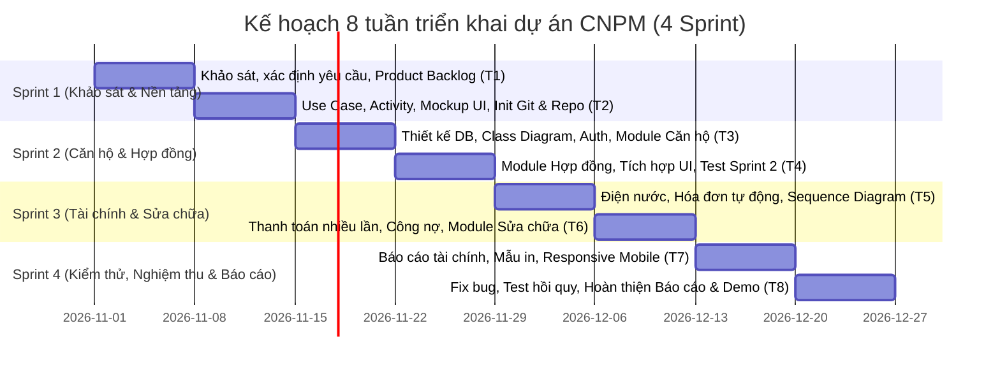

# 📋 KẾ HOẠCH PHÂN CHIA CÔNG VIỆC DỰ ÁN BTL CÔNG NGHỆ PHẦN MỀM
## Đề tài: Hệ Thống Quản Lý Cho Thuê Căn Hộ Dịch Vụ
> **Phương pháp tiếp cận:** Agile / Scrum (8 tuần — 4 Sprint, 2 tuần/Sprint)  
> **Quy mô:** 9 thành viên (5 DT — Development Team + 4 rAI — Business Analyst & Quality/Documentation)  
> **Áp dụng chuẩn:** Báo cáo môn học CNPM, chuẩn UML 2.5, Quản lý mã nguồn trên Git / GitHub

---

## 🎯 1. Mục tiêu cụ thể hóa theo mô hình SMART (Mục 1.2.3)

| Thành phần SMART | Nội dung áp dụng trong dự án |
|---|---|
| **Cụ thể (Specific)** | Xây dựng phần mềm web hoàn chỉnh quản lý căn hộ dịch vụ với các phân hệ: Quản lý tài khoản & phân quyền (RBAC); Quản lý căn hộ, tình trạng phòng, hồ sơ khách thuê; Quản lý hợp đồng thuê; Ghi nhận chỉ số điện nước theo kỳ; Lập hóa đơn tự động; Ghi nhận thanh toán nhiều lần và theo dõi công nợ lũy kế; Tiếp nhận và xử lý yêu cầu sửa chữa/sự cố; Báo cáo tài chính (phải thu, thực thu, công nợ). |
| **Đo lường được (Measurable)** | - Hoàn thành 100% yêu cầu chức năng cốt lõi bắt buộc đã chốt.<br>- Xây dựng tối thiểu **30 test cases** kiểm thử toàn diện.<br>- Đạt 100% test cases nghiệp vụ cốt lõi trước ngày nghiệm thu.<br>- 0 lỗi nghiêm trọng (Critical/Blocker) gây sai lệch tiền tệ, mất mát dữ liệu hoặc truy cập trái quyền. |
| **Khả thi (Achievable)** | Tổ chức 9 thành viên phối hợp chặt chẽ theo chuyên môn (Frontend, Backend, Database, QA/Tester, Business Analyst, Báo cáo & Tài liệu). Ưu tiên làm chắc các chức năng cốt lõi trước, các tính năng nâng cao (IoT điện nước, thanh toán trực tuyến) để ở giai đoạn phát triển sau. |
| **Phù hợp (Relevant)** | Giải quyết trực tiếp các bài toán nhức nhối thực tế đã ghi nhận từ khảo sát: loại bỏ sai sót tính nhẩm/Excel, đối soát minh bạch tiền khách đóng nhiều đợt, lưu trữ lịch sử điện nước không bị thất lạc, chuẩn hóa quy trình xử lý sự cố. |
| **Có thời hạn (Time-bound)** | Thực hiện nghiêm ngặt trong **8 tuần**, chia đều làm **4 Sprint** (mỗi Sprint kéo dài đúng 2 tuần). |

---

## 👥 2. Phân chia công việc theo 2 khối vai trò: DT và rAI

Dự án được phân chia thành **2 khối vai trò chính** (theo đúng Bảng 1.5):
- **Khối DT (Development Team - 5 thành viên):** Chịu trách nhiệm toàn bộ về mặt Kỹ thuật — Kiến trúc, Cơ sở dữ liệu, Lập trình Frontend/Backend, Tích hợp hệ thống, Kiểm thử tự động và Đóng gói phát hành.
- **Khối rAI (Research, Analysis & Information / AI Governance - 4 thành viên):** Chịu trách nhiệm Khảo sát thực tế, Phân tích nghiệp vụ chi tiết, Mô hình hóa (Use Case, Activity), Thiết lập bộ dữ liệu mẫu (Golden Data), Chuẩn hóa toàn bộ quyển Báo cáo môn học và Quản lý Đạo đức/Nhật ký AI (Phụ lục Z).

```
┌────────────────────────────────────────────────────────────────────────────────────────┐
│                                 MÔ HÌNH PHỐI HỢP LIÊN VAI TRÒ                         │
├───────────────────────────────────────────┬────────────────────────────────────────────┤
│   KHỐI rAI (Khảo sát, Phân tích & Báo cáo) │    KHỐI DT (Phát triển Kỹ thuật & Test)    │
├───────────────────────────────────────────┼────────────────────────────────────────────┤
│ • Nguyễn Hải Long (BA Core)               │ ──> • Nguyễn Đình Đức (DB & Backend Core) │
│ • Bùi Phương Minh (BA Tài chính)          │ ──> • Nguyễn Hoàng Long (Backend Finance)  │
│ • Nguyễn Tuyết Mai (BA Sửa chữa & Khảo sát)│ ──> • Ninh Văn Thành Trung (Auth & Repair) │
│ • Vũ Thị Thanh (Lead Doc, NFR & AI Policy)│ ──> • Vũ Thị Thùy Dung (Frontend UI/UX)   │
│                                           │ ──> • Nguyễn Đình Ước (QA/QC Test Lead)   │
└───────────────────────────────────────────┴────────────────────────────────────────────┘
```

---

### 🅰️ KHỐI DT (DEVELOPMENT TEAM — 5 THÀNH VIÊN KỸ THUẬT)

#### 1. Vũ Thị Thùy Dung [DT] — Frontend & UI/UX Engineer
- **Vị trí / Vai trò:** Kỹ sư giao diện người dùng (Frontend Lead & UI/UX Designer).
- **Thư mục mã nguồn phụ trách trên Git:** `src/frontend/`
- **Nhánh Git:** `feature/dung-ui`
- **Nhiệm vụ cụ thể:**
  1. Thiết kế Mockup / Wireframe mẫu cho toàn bộ các màn hình hệ thống.
  2. Lập trình giao diện người dùng cho phân hệ **Quản lý** (Dashboard, Quản lý phòng, Hợp đồng, Nhập điện nước, Hóa đơn, Quản lý sửa chữa).
  3. Lập trình giao diện cho phân hệ **Khách thuê** (Xem thông tin phòng, xem hóa đơn, gửi yêu cầu sửa chữa).
  4. Kết nối giao diện với hệ thống RESTful APIs từ các bạn Backend (Đức, Long, Trung).
  5. Tối ưu hiển thị đa thiết bị (Responsive Design) tương thích mượt mà trên Desktop/Laptop, Tablet và Điện thoại thông minh (Mobile).
- **Sản phẩm bàn giao:**
  - Bộ giao diện mẫu (Mockup/Figma/Wireframe);
  - Mã nguồn hoàn chỉnh thư mục `src/frontend/`;
  - Màn hình giao diện đã kết nối dữ liệu thật và vượt qua bài test hiển thị đa thiết bị.

#### 2. Nguyễn Đình Đức [DT] — Database & Core Backend Engineer
- **Vị trí / Vai trò:** Kỹ sư CSDL & Backend phân hệ cốt lõi (Căn hộ, Khách thuê, Hợp đồng).
- **Thư mục mã nguồn phụ trách trên Git:** `src/backend/modules/apartments/`, `src/backend/modules/customers/`, `src/backend/modules/contracts/`
- **Nhánh Git:** `feature/duc-core`
- **Nhiệm vụ cụ thể:**
  1. Chủ trì thiết kế CSDL (Mô hình thực thể ERD, Physical Database Schema, các ràng buộc toàn vẹn khóa chính - khóa ngoại).
  2. Phối hợp chuẩn hóa và vẽ biểu đồ **Class Diagram** (Mục 1.7.3 Tuần 3-4).
  3. Lập trình Backend APIs cho phân hệ Quản lý Căn hộ (CRUD phòng, lọc trạng thái phòng: trống, đã thuê, sửa chữa).
  4. Lập trình Backend APIs cho phân hệ Hồ sơ khách thuê (thông tin cá nhân, CCCD, thông tin liên hệ).
  5. Lập trình Backend APIs cho phân hệ Quản lý Hợp đồng (lập hợp đồng mới, tính tiền cọc, gia hạn, thanh lý hợp đồng).
- **Sản phẩm bàn giao:**
  - Script khởi tạo CSDL (`schema.sql` hoặc DB Migrations);
  - File biểu đồ **Class Diagram** chuẩn UML 2.5;
  - Mã nguồn Backend phân hệ Căn hộ, Khách thuê và Hợp đồng.

#### 3. Nguyễn Hoàng Long [DT] — Financial & Billing Backend Engineer
- **Vị trí / Vai trò:** Kỹ sư Backend phân hệ Tài chính, Điện nước, Hóa đơn & Công nợ.
- **Thư mục mã nguồn phụ trách trên Git:** `src/backend/modules/utilities/`, `src/backend/modules/invoices/`, `src/backend/modules/payments/`
- **Nhánh Git:** `feature/long-finance`
- **Nhiệm vụ cụ thể:**
  1. Lập trình phân hệ Ghi nhận chỉ số điện nước theo từng kỳ và từng căn hộ; kiểm soát tính hợp lệ (chỉ số mới ≥ chỉ số cũ, không trùng kỳ).
  2. Lập trình thuật toán tự động sinh Hóa đơn hàng tháng (Tiền phòng + Tiền điện + Tiền nước + Phí dịch vụ phát sinh).
  3. Lập trình chức năng ghi nhận thanh toán nhiều lần cho cùng một hóa đơn (khách trả góp/trả trước một phần).
  4. Lập trình thuật toán bù trừ và theo dõi công nợ lũy kế.
  5. Xây dựng APIs xuất báo cáo tài chính tổng hợp: Số tiền phải thu, Số tiền thực thu và Tổng công nợ còn lại.
- **Sản phẩm bàn giao:**
  - Mã nguồn Backend phân hệ Tài chính & Điện nước;
  - APIs tổng hợp báo cáo tài chính;
  - Kết quả kiểm thử thuật toán tính tiền khớp 100% với bộ dữ liệu mẫu (Golden dataset) của bạn Bùi Phương Minh.

#### 4. Ninh Văn Thành Trung [DT] — Security, Auth & Maintenance Backend Engineer
- **Vị trí / Vai trò:** Kỹ sư Bảo mật, Xác thực & Backend phân hệ Quản lý Sự cố sửa chữa.
- **Thư mục mã nguồn phụ trách trên Git:** `src/backend/modules/auth/`, `src/backend/modules/maintenance/`
- **Nhánh Git:** `feature/trung-auth-repair`
- **Nhiệm vụ cụ thể:**
  1. Xây dựng hệ thống Đăng nhập, Đăng xuất, Quản lý Token/Session và Phân quyền truy cập (RBAC) chặt chẽ giữa Quản lý và Khách thuê.
  2. Mã hóa an toàn thông tin nhạy cảm (mật khẩu hash/bcrypt), bảo vệ các routes API tránh truy cập trái phép.
  3. Lập trình phân hệ Quản lý yêu cầu sửa chữa: Khách thuê gửi phản ánh sự cố; Quản lý tiếp nhận, điều phối thợ, cập nhật trạng thái (`Mới` → `Đang xử lý` → `Hoàn thành`) và lưu vết lịch sử.
  4. Phụ trách vẽ biểu đồ **Sequence Diagram** cho luồng Đăng nhập/Xác thực và luồng Xử lý yêu cầu sửa chữa (Mục 1.7.3 Tuần 5-6).
- **Sản phẩm bàn giao:**
  - Mã nguồn Backend phân hệ Xác thực (Auth/RBAC) và phân hệ Yêu cầu sửa chữa;
  - File biểu đồ **Sequence Diagram** liên quan đến các luồng phụ trách.

#### 5. Nguyễn Đình Ước [DT] — QA / QC Test Lead & Release Engineer
- **Vị trí / Vai trò:** Trưởng nhóm Kiểm thử phần mềm (QA/QC Lead) & Kỹ sư Đóng gói phát hành.
- **Thư mục mã nguồn & tài liệu phụ trách trên Git:** `tests/`, `docs/test_plans/`
- **Nhánh Git:** `feature/uoc-test-release`
- **Nhiệm vụ cụ thể:**
  1. Chủ trì lập Kế hoạch kiểm thử tổng thể (Test Plan) cho cả 4 Sprint.
  2. Xây dựng và thực thi bộ kịch bản kiểm thử (Test Cases) tối thiểu **30 ca kiểm thử** bao phủ đầy đủ: Happy path, kiểm thử biên, dữ liệu không hợp lệ và kiểm tra bảo mật phân quyền.
  3. Thực hiện kiểm thử tích hợp (Integration Test) và kiểm thử hồi quy (Regression Test) mỗi khi nhóm tích hợp mã nguồn vào `develop`.
  4. Quản lý danh mục lỗi (Bug Log), phân loại độ nghiêm trọng, theo dõi quá trình sửa lỗi của các thành viên DT.
  5. Chuẩn bị môi trường chạy thử hệ thống, đóng gói bản demo và viết tài liệu Hướng dẫn sử dụng (User Manual).
- **Sản phẩm bàn giao:**
  - Kế hoạch kiểm thử (Test Plan);
  - Bộ 30+ Test Cases chi tiết (`docs/test_plans/test_cases.md`);
  - Danh mục lỗi (Bug Log) và Báo cáo kiểm thử tổng kết;
  - Bản chạy thử nghiệm thu và Tài liệu Hướng dẫn sử dụng.

---

### 🅱️ KHỐI rAI (RESEARCH, ANALYSIS & INFORMATION / AI GOVERNANCE — 4 THÀNH VIÊN)

#### 6. Nguyễn Hải Long [rAI] — Business Analyst (Core Modules)
- **Vị trí / Vai trò:** Chuyên viên phân tích nghiệp vụ phân hệ Cốt lõi (Căn hộ, Khách thuê, Hợp đồng).
- **Thư mục tài liệu phụ trách trên Git:** `docs/surveys/core/`, `docs/uml/usecases/`
- **Nhánh Git:** `docs/hailong-ba`
- **Nhiệm vụ cụ thể:**
  1. Thực hiện khảo sát thực tế quy trình vận hành căn hộ dịch vụ: cách quản lý danh sách phòng, bàn giao căn hộ, thu thập hồ sơ khách và ký kết hợp đồng.
  2. Xác định các điểm nghẽn, khó khăn và rủi ro thất thoát thông tin khi quản lý thủ công.
  3. Xây dựng tài liệu Đặc tả yêu cầu chức năng (Functional Requirements - FR) cho phân hệ Căn hộ, Khách thuê, Hợp đồng.
  4. Xây dựng và viết chi tiết các kịch bản **Đặc tả Use Case (Use Case Specifications)** cho toàn bộ luồng nghiệp vụ cốt lõi.
  5. Bàn giao đặc tả và phối hợp với bạn Nguyễn Đình Đức [DT] để thiết kế CSDL và lập trình đúng nghiệp vụ.
- **Sản phẩm bàn giao:**
  - Nội dung và biên bản khảo sát thực tế;
  - Danh sách yêu cầu chức năng nghiệp vụ cốt lõi;
  - Bộ tài liệu đặc tả Use Case chi tiết Quản lý Căn hộ, Khách thuê và Hợp đồng.

#### 7. Bùi Phương Minh [rAI] — Business Analyst (Financial & Billing Modules)
- **Vị trí / Vai trò:** Chuyên viên phân tích nghiệp vụ Tài chính, Điện nước, Hóa đơn & Công nợ.
- **Thư mục tài liệu phụ trách trên Git:** `docs/surveys/finance/`, `docs/uml/activity/`
- **Nhánh Git:** `docs/minh-finance`
- **Nhiệm vụ cụ thể:**
  1. Phân tích chi tiết quy trình chốt số điện nước, biểu giá điện nước (bậc thang hoặc giá khoán).
  2. Phân tích nghiệp vụ lập hóa đơn hàng tháng, xử lý thanh toán nhiều lần và thuật toán bù trừ công nợ.
  3. Làm rõ các công thức tính toán, dữ liệu đầu vào và các trường hợp ngoại lệ (khách vào giữa tháng, chỉ số giảm do đổi đồng hồ, khách trả thừa/thiếu).
  4. Xây dựng biểu đồ hoạt động **Activity Diagram** quy trình ghi điện nước, tính phí và thanh toán (Mục 1.7.3 Tuần 1-2).
  5. Xây dựng **Bộ dữ liệu kiểm thử chuẩn (Golden Dataset)** với các số liệu thực tế để đối soát độ chính xác với Nguyễn Hoàng Long [DT] và Nguyễn Đình Ước [DT].
- **Sản phẩm bàn giao:**
  - Tài liệu quy tắc nghiệp vụ tài chính và công thức tính phí chi tiết;
  - Tài liệu đặc tả chức năng điện nước, hóa đơn và công nợ;
  - Biểu đồ **Activity Diagram** quy trình tài chính;
  - Bộ dữ liệu mẫu (Golden Dataset) đối chiếu tính toán.

#### 8. Vũ Thị Thanh [rAI] — Project Coordinator, Document Lead & AI Policy Manager
- **Vị trí / Vai trò:** Trưởng nhóm Tài liệu & Điều phối dự án, Quản lý Quy chuẩn AI.
- **Thư mục tài liệu phụ trách trên Git:** `docs/reports/`, `QUY_TAC_SU_DUNG_AI.md`
- **Nhánh Git:** `docs/thanh-lead`
- **Nhiệm vụ cụ thể:**
  1. Nghiên cứu, đánh giá và lập bảng so sánh chi tiết các hệ thống liên quan: Sổ ghi chép/Excel, Smartos PMS, Landsoft Building và hệ thống đề xuất của nhóm (Mục 1.3).
  2. Xác định các nhóm tác nhân (Actors) và xây dựng **Ma trận phân quyền (RBAC Matrix)** giữa Quản trị viên và Khách thuê.
  3. Phân tích và soạn thảo danh mục **Yêu cầu phi chức năng (Non-Functional Requirements - NFR)** về giao diện, độ bảo mật, hiệu năng và tính khả dụng.
  4. Viết đặc tả Use Case cho chức năng Đăng nhập và Đăng xuất.
  5. Chủ trì thu thập, tổng hợp, hiệu đính và chuẩn hóa toàn bộ quyển **Báo cáo đồ án môn học** (file văn bản Word/Google Docs) theo đúng quy chuẩn trình bày của Khoa/Trường: căn lề, mục lục, bảng biểu lặp lại tiêu đề trang 2, trích dẫn tài liệu tham khảo đúng chuẩn CNPM.
  6. Quản lý việc tuân thủ quy tắc sử dụng AI (Mục 1.8 - AUR.01 đến AUR.99) và chủ trì biên soạn **Phụ lục Z: Nhật ký sử dụng AI** kèm hệ thống footnote dẫn chiếu trong toàn bộ báo cáo.
- **Sản phẩm bàn giao:**
  - Bảng so sánh các hệ thống liên quan (Mục 1.3.4);
  - Ma trận phân quyền (RBAC Matrix);
  - Bảng đặc tả Use Case Đăng nhập, Đăng xuất;
  - Danh sách yêu cầu phi chức năng (NFR);
  - Quyển Báo cáo tổng hợp môn học hoàn chỉnh;
  - Phụ lục Z: Nhật ký sử dụng AI hoàn chỉnh.

#### 9. Nguyễn Tuyết Mai [rAI] — Business Analyst (Maintenance & Survey Lead)
- **Vị trí / Vai trò:** Chuyên viên phân tích nghiệp vụ Sửa chữa & Khảo sát số liệu thực tế.
- **Thư mục tài liệu phụ trách trên Git:** `docs/surveys/maintenance/`, `docs/uml/activity/`
- **Nhánh Git:** `docs/mai-survey`
- **Nhiệm vụ cụ thể:**
  1. Trực tiếp khảo sát thực tế về cách tiếp nhận và xử lý sự cố thiết bị tại các căn hộ dịch vụ; xác định các khó khăn và nhu cầu lưu vết lịch sử sửa chữa.
  2. Xác định các trường dữ liệu cần lưu trữ và định nghĩa chu trình trạng thái của phiếu sửa chữa (`Mới` → `Đang xử lý` → `Hoàn thành`).
  3. Xây dựng biểu đồ hoạt động **Activity Diagram** mô tả toàn diện quy trình tiếp nhận, phân công thợ và nghiệm thu sửa chữa (Mục 1.7.3 Tuần 1-2).
  4. Tổng hợp, kiểm tra và thống kê số liệu khảo sát sơ bộ của nhóm (vẽ biểu đồ tỷ lệ, phân tích khó khăn); thực hiện **ẩn danh hóa dữ liệu (Data Anonymization)** để bảo mật thông tin người được khảo sát theo chuẩn học thuật.
  5. Bàn giao kết quả phân tích cho Ninh Văn Thành Trung [DT] để lập trình module sửa chữa.
- **Sản phẩm bàn giao:**
  - Bảng tổng hợp số liệu khảo sát đã được ẩn danh;
  - Tài liệu đặc tả Use Case nghiệp vụ Tiếp nhận & Xử lý yêu cầu sửa chữa;
  - File biểu đồ **Activity Diagram** quy trình sửa chữa.

---

## 📅 3. Kế hoạch triển khai theo tuần (Tuần 1 — Tuần 8 / 4 Sprint) (Mục 1.7.2)



### 🗓️ Chi tiết từng tuần:

#### 🔹 Tuần 1: Khởi động & Khảo sát nghiệp vụ
* **Trọng tâm:** Đối chiếu kết quả khảo sát thực tế; làm rõ quy trình tại cơ sở; thu thập mẫu biểu hợp đồng, hóa đơn, sổ ghi điện nước; xác định các tác nhân (Actors), phạm vi hệ thống và danh sách yêu cầu bắt buộc.
* **Người thực hiện:** Nguyễn Hải Long, Bùi Phương Minh, Nguyễn Tuyết Mai, Vũ Thị Thanh (chủ trì); toàn nhóm góp ý.
* **Kết quả đầu ra:** Tài liệu khảo sát nghiệp vụ, Danh sách yêu cầu ban đầu (FR & NFR), Product Backlog sơ bộ.

#### 🔹 Tuần 2: Chốt yêu cầu, Mô hình hóa & Dựng nền tảng (Review Sprint 1)
* **Trọng tâm:** Chốt tiêu chí chấp nhận cho các User Stories; xây dựng Use Case Diagram tổng quan và các Activity Diagram luồng chính; phác thảo Mockup giao diện; khởi tạo kho lưu trữ Git trên GitHub, thiết lập môi trường lập trình và khung mã nguồn (base project).
* **Người thực hiện:** Vũ Thị Thùy Dung (Mockup UI), Nguyễn Hải Long & Bùi Phương Minh & Nguyễn Tuyết Mai (UML), Nguyễn Đình Đức & Ninh Văn Thành Trung (Setup Git repo, backend skeleton).
* **Kết quả đầu ra:** Bộ biểu đồ Use Case & Activity Diagram tổng quan, Bộ giao diện mẫu (Mockup/Wireframe), Git Repository hoạt động, Biên bản rà soát kết thúc Sprint 1.

#### 🔹 Tuần 3: Thiết kế CSDL & Xây dựng phân hệ Cốt lõi
* **Trọng tâm:** Thiết kế mô hình dữ liệu quan hệ (ERD) và Class Diagram; xây dựng phân hệ Đăng nhập, Quản lý tài khoản và Phân quyền truy cập (RBAC); bắt đầu lập trình phân hệ Quản lý căn hộ và Hồ sơ khách thuê.
* **Người thực hiện:** Nguyễn Đình Đức (chủ trì DB, Class Diagram & CRUD Căn hộ/Khách), Ninh Văn Thành Trung (Auth/RBAC), Vũ Thị Thùy Dung (giao diện Căn hộ & Khách thuê).
* **Kết quả đầu ra:** CSDL ban đầu (Schema SQL), Class Diagram, Phân hệ Xác thực & Quản lý Căn hộ/Khách thuê cơ bản.

#### 🔹 Tuần 4: Quản lý Hợp đồng & Tích hợp giao diện (Review Sprint 2)
* **Trọng tâm:** Hoàn thiện chức năng lập và quản lý hợp đồng thuê căn hộ, kiểm soát tình trạng phòng; tích hợp giao diện người dùng với APIs; thực hiện kiểm thử tạo, sửa, tìm kiếm và kiểm tra các trường hợp nhập dữ liệu không hợp lệ.
* **Người thực hiện:** Nguyễn Đình Đức (Hợp đồng), Vũ Thị Thùy Dung (Tích hợp UI), Nguyễn Đình Ước (Thực thi Test Cases cho Sprint 2), Nguyễn Hải Long (kiểm tra đối chiếu nghiệp vụ).
* **Kết quả đầu ra:** Luồng quản lý phòng - khách - hợp đồng chạy liên kết trơn tru; Báo cáo kiểm thử Sprint 2.

#### 🔹 Tuần 5: Phân hệ Điện nước & Lập Hóa đơn tự động
* **Trọng tâm:** Xây dựng chức năng ghi chỉ số điện nước theo kỳ; cấu hình đơn giá dịch vụ; xây dựng thuật toán tự động sinh hóa đơn hàng tháng; vẽ Sequence Diagram cho luồng lập hóa đơn; kiểm tra kết quả tính tiền theo bộ dữ liệu mẫu (Golden dataset).
* **Người thực hiện:** Nguyễn Hoàng Long (chủ trì Backend Billing), Bùi Phương Minh (cung cấp công thức & Golden data), Ninh Văn Thành Trung (hỗ trợ Sequence Diagram), Vũ Thị Thùy Dung (giao diện nhập chỉ số và xem hóa đơn).
* **Kết quả đầu ra:** Phân hệ ghi chỉ số và tự động sinh hóa đơn hoạt động chính xác; Sequence Diagram Lập hóa đơn.

#### 🔹 Tuần 6: Thanh toán nhiều lần, Quản lý Sự cố sửa chữa (Review Sprint 3)
* **Trọng tâm:** Lập trình chức năng ghi nhận khách thanh toán nhiều đợt cho cùng hóa đơn, tự động bù trừ công nợ; xây dựng phân hệ tiếp nhận, xử lý và lưu vết lịch sử yêu cầu sửa chữa; kiểm thử bảo mật phân quyền (khách thuê không xem được hóa đơn/yêu cầu của phòng khác).
* **Người thực hiện:** Nguyễn Hoàng Long (Thanh toán & Công nợ), Ninh Văn Thành Trung (Module Sửa chữa), Nguyễn Tuyết Mai (đối soát luồng sửa chữa), Nguyễn Đình Ước (Kiểm thử liên phân hệ Sprint 3).
* **Kết quả đầu ra:** Phân hệ tài chính và phân hệ sửa chữa hoàn thành tích hợp; Biên bản rà soát kết thúc Sprint 3.

#### 🔹 Tuần 7: Báo cáo tài chính, Mẫu in & Tối ưu Responsive đa thiết bị
* **Trọng tâm:** Xây dựng dashboard báo cáo tổng hợp: Số tiền phải thu, Thực thu, Công nợ tích lũy; bổ sung chức năng xuất mẫu in hóa đơn; tinh chỉnh giao diện hiển thị tối ưu trên thiết bị di động (Mobile Web); tiến hành kiểm thử tích hợp toàn hệ thống.
* **Người thực hiện:** Nguyễn Hoàng Long (API Báo cáo), Vũ Thị Thùy Dung (Tối ưu giao diện Mobile & Mẫu in), Nguyễn Đình Ước (Thực thi bộ 30+ Test Cases), Vũ Thị Thanh (rà soát NFR và biên tập báo cáo).
* **Kết quả đầu ra:** Bản phần mềm phiên bản Release Candidate (gần hoàn chỉnh), Danh mục lỗi (Bug log) toàn hệ thống.

#### 🔹 Tuần 8: Sửa lỗi, Kiểm thử hồi quy, Chuẩn hóa Báo cáo & Nghiệm thu
* **Trọng tâm:** Khắc phục triệt để các lỗi phát sinh, thực hiện kiểm thử hồi quy; cập nhật lại toàn bộ tài liệu và biểu đồ UML cho khớp 100% với code thực tế; đóng gói bản chạy thử và viết User Manual; hoàn thiện quyển Báo cáo tổng thể và chuẩn bị slide thuyết trình demo.
* **Người thực hiện:** Toàn bộ 9 thành viên tham gia, trong đó: Nguyễn Đình Ước (chủ trì Test hồi quy), Vũ Thị Thanh (chủ trì hoàn thiện quyển Báo cáo & Phụ lục Z), Nguyễn Đình Đức & Thùy Dung (chuẩn bị bản demo).
* **Kết quả đầu ra:** Bản nghiệm thu phần mềm hoàn chỉnh, Mã nguồn sạch trên GitHub, Quyển Báo cáo toàn diện (Word/PDF), Bộ Test Cases & Báo cáo kiểm thử đạt chuẩn.

---

## 📊 4. Ma trận trách nhiệm RACI cho 9 thành viên

*(R = Responsible - Người thực hiện chính; A = Accountable - Người chịu trách nhiệm phê duyệt/kết quả cuối cùng; C = Consulted - Người được tham vấn chuyên môn; I = Informed - Người được thông báo kết quả)*

| Hạng mục công việc | Thùy Dung | Đình Đức | Hoàng Long | Thành Trung | Đình Ước | Hải Long | Phương Minh | Thị Thanh | Tuyết Mai |
|---|:---:|:---:|:---:|:---:|:---:|:---:|:---:|:---:|:---:|
| **Khảo sát nghiệp vụ & Viết FR** | I | C | C | C | I | **R/A** | R | R | R |
| **So sánh hệ thống & Viết NFR** | I | I | I | I | I | C | C | **R/A** | C |
| **Thiết kế UI/UX & Responsive Web** | **R/A** | C | C | C | C | I | I | C | I |
| **Thiết kế CSDL & Class Diagram** | C | **R/A** | C | C | C | C | C | I | I |
| **Phân hệ Auth, RBAC & Sequence** | C | C | I | **R/A** | C | I | I | C | I |
| **Phân hệ Căn hộ, Khách & Hợp đồng** | C | **R/A** | I | I | C | C | I | I | I |
| **Phân hệ Điện nước, Hóa đơn & Công nợ**| C | C | **R/A** | I | C | I | C | I | I |
| **Phân hệ Quản lý Yêu cầu Sửa chữa** | C | I | I | **R/A** | C | I | I | I | C |
| **Lập kế hoạch & Bộ 30+ Test Cases** | C | C | C | C | **R/A** | I | C | I | I |
| **Thực hiện Test & Bug Tracking** | C | C | C | C | **R/A** | I | I | I | I |
| **Tổng hợp Báo cáo & Phụ lục Z (AI)** | C | C | C | C | C | C | C | **R/A** | C |
| **Đóng gói bản demo & User Manual** | C | C | C | C | **R/A** | I | I | C | I |

---

## ✅ 5. Định nghĩa hoàn thành (Definition of Done - DoD) (Mục 1.4.3)

Một công việc hoặc chức năng chỉ được xác nhận hoàn thành khi thỏa mãn đầy đủ 6 tiêu chuẩn sau:
1. **Đáp ứng nghiệp vụ:** Thỏa mãn 100% yêu cầu chức năng và tiêu chí chấp nhận (Acceptance Criteria) đã thống nhất trong Sprint Planning.
2. **Tích hợp Git:** Mã nguồn đã được tạo Pull Request, vượt qua kiểm tra xung đột (conflict-free) và được merge thành công vào nhánh chung `develop`.
3. **Kiểm thử đầy đủ:** Đã thực hiện kiểm thử thành công các trường hợp hợp lệ, trường hợp biên, trường hợp dữ liệu không hợp lệ và kiểm tra quyền truy cập tương ứng.
4. **Code Review:** Đã được ít nhất một thành viên kỹ thuật khác trong nhóm rà soát (Code Review) và phê duyệt trên GitHub.
5. **Cập nhật tài liệu & UML:** Biểu đồ UML liên quan (Class, Sequence, Activity) và tài liệu API được cập nhật khớp với mã nguồn thực tế.
6. **Không còn lỗi nghiêm trọng:** Không còn bất kỳ lỗi nào ở mức Block/Critical gây gián đoạn quy trình hoặc sai lệch dữ liệu tài chính.
